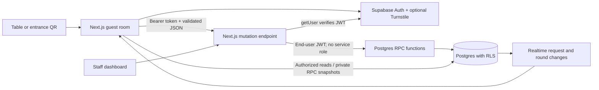

# VibePub architecture

## Current release

Guests scan a table QR or the entrance/pub-floor QR, receive a persistent anonymous Supabase Auth identity and join the venue's active session. In that session they can request and vote on songs, play staff-hosted trivia/polls, accumulate table scores and opt into guest introductions. Intro invitations require recipient acceptance; a guest can hide their profile or block another guest for the night. Staff sign in with a provisioned permanent account at `/host` to launch/close rounds and print QR codes.

The application is now deployed publicly through Sites at https://vibepub-live-night.truekrill4096.chatgpt.site. The canonical source remains Next.js; a separate Sites/Vinext adapter serves the Cloudflare-hosted copy. The workspace is now connected to hosted Supabase and Auth/data/Realtime checks passed; CAPTCHA, staff login and physical-device verification remain to be completed. A downloaded copy needs its own environment configuration. The offline preview uses clearly labeled sample data and local component state.

## Components and trust boundaries

Next.js App Router renders the shell. Client components fetch guest-specific data, preventing shared server caches from leaking guest sessions. Supabase persists and refreshes browser Auth sessions. The mutation endpoint bounds request bodies to 4096 actual bytes, validates discriminated payloads with Zod, verifies the JWT with `getUser`, and calls narrowly scoped SQL functions using the same end-user JWT. SQL repeats validation and authorization because clients can call Supabase RPC directly.

## Data model

| Tables | Purpose and key rules |
| --- | --- |
| venues, venue_tables | Venue identity and random QR admission tokens; table list is hidden from guests |
| sessions | One active entertainment night per venue via partial unique index |
| memberships | Guest/night/team assignment; user + session primary key; first team retained |
| song_requests, votes | Case-insensitive unique song per session; one guest vote per track; trigger-maintained count |
| venue_staff | Admin-provisioned user/venue assignments; no guest direct read/write |
| game_rounds | Trivia/poll, question, 2–4 options and open/closed state; at most one open round per session |
| game_keys | Private correct answer; no guest direct SELECT, even for staff |
| game_answers | One locked response per guest/round; guests can read only their own answers |
| guest_profiles | Session-scoped nickname/short introduction; hidden unless explicitly discoverable |
| introductions | Directed private pending/accepted/declined invitations; recipient alone can respond |
| guest_blocks | Session-scoped blocks; directory and invitation filters apply symmetrically |

All guest identities reference `auth.users`. Memberships connect team scores and social profiles to the venue session. A shared entrance QR is a `venue_tables` row labeled `Pub floor`, so it uses the same admission and authorization path without needing a physical table. It is a shareable capability, not a geolocation guarantee.

## Song flow

Join via QR → restore/create anonymous Auth identity → `join_table` validates the token and active session → fetch the board and subscribe to request changes. Requests validate text, membership and active session, then enforce five requests per guest/session using an advisory lock. Duplicate track identity uses normalized title/artist. Voting inserts a unique guest/request row, making repeated calls idempotent. A trigger increments the request's authoritative count, emitting an UPDATE for Realtime. Sort by vote count descending, creation time ascending, UUID as final tie-breaker. A 15-second refresh repairs missed events.

## Games and host flow

A database administrator creates a permanent Auth user and assigns it in `venue_staff`. The dashboard discovers only sessions for which `is_staff` returns true. UI state is not authority: every host RPC independently checks the staff assignment for that venue.

`host_round` validates unique options, a valid correct index for trivia, and an active session. Answer keys are stored separately and cannot be selected by guests. `answer_round` validates membership and active/open state and locks a single answer. `close_round` changes round state. Only then does `game_results` expose correct index and aggregated counts; open-round results return null, including to hosts. `table_scores` counts ten points per correct answer on closed trivia rounds. Polls do not affect points.

Session locks and round locks serialize answer acceptance with closure. One guest cannot overwrite a locked answer or insert a forged score. Realtime on `game_rounds` signals launches/closures; authenticated reads refresh every eight seconds as reconciliation. No public answer broadcasts are used. Hosts close rounds manually; no timed scoring or audio playback is implemented.

## Opt-in introductions

`save_profile` requires membership in an active session and bounded nickname/intro fields. A default guest has no profile and is undiscoverable. Both people must have opted in before either can appear in the other's directory or send an invitation. `send_intro` limits each sender to ten invitations per night and prevents duplicate/reverse invitations. `respond_intro` requires the recipient and a pending, available invitation.

Social tables have no direct guest SELECT or write grants. `social_board` returns a private snapshot of the caller's profile, mutually opted-in people, and only invitations involving the caller. Blocked people are excluded symmetrically. Staff have no special guest-directory access without normal session membership and opt-in. Profiles are not a live presence indicator and do not expose contact details or table locations.

Hiding marks the profile undiscoverable and revokes all current invitations, including accepted ones. Blocking records a session block and revokes the pair's invitations. All social writes share a per-session advisory lock so opt-out, block, send and accept cannot race past each other. Session closure disables social snapshots and new profile/invitation changes. Clients poll authenticated snapshots every eight seconds and remove directory data when reads fail. Information already seen cannot be recalled from another person's memory or device.

No private chat, photos, contact exchange, public profile URLs or report-handling queue is implemented. The venue needs an operational contact for complaints before a public pilot. Blocks last for that session; there is no unblock control yet.

## Database security

Every application table has RLS. Guest direct write privileges are revoked. Authenticated guests may read joined session requests/rounds, own memberships/votes/answers, and session metadata. Venue/table/staff records, answer keys and social tables have no guest direct access. Definer functions use empty `search_path`, qualified relations and explicit permission checks. Default PUBLIC function execution is revoked; only intended entry points are granted to `authenticated`. The internal social helper is not callable by guests.

JWT verification happens at the API and `auth.uid()` is the identity inside Postgres. There is no service-role credential in application code. Guests cannot provide their own user ID, point total, staff role or sender identity. Anonymous users still have the authenticated database role, so policies must check membership rather than assuming all authenticated users are staff.

CAPTCHA tokens flow from the optional Turnstile widget to Supabase Auth. The site key is public; its matching secret is configured only in Supabase Auth. Per-identity quotas do not prevent identity resets or remote joins using a shared QR URL. Production hosting also needs suitable edge/Auth rate limits and monitoring.

## Design and deployment

The interface uses a dark canvas (`#101014`), raised panels, lime primary actions (`#c2ff65`) and lavender track accents. Guest activity navigation separates song requests, pub games and meeting the crowd. Large tap controls, keyboard focus outlines, pressed-state buttons, status/error messages and native modal semantics support mobile use. No remote font or artwork download is required.

Next standalone output and a postbuild asset-copy step support `npm start` and the non-root multi-stage Docker image. CI installs the lockfile, runs tests, generates/checks route types and builds. Vercel setup is documented as another deployment path. `/api/health` reports process configuration without pretending to probe Supabase. `deploy:check` validates environment shape but cannot establish that migrations, Auth CAPTCHA or Realtime are configured correctly.

## Future work

Owner onboarding, staff invitations/MFA, DJ queue moderation, richer venue settings, reporting workflows and retention automation remain future work. Music catalog IDs can replace free-text matching. Future games can add timed rounds, music guessing with licensed audio and richer activity scheduling. Rewards need an immutable points ledger, redemption inventory and staff confirmation. Measure snapshot query load and Realtime fanout before expanding beyond a small venue pilot.

## Primary references

- [Supabase anonymous Auth](https://supabase.com/docs/guides/auth/auth-anonymous)
- [Supabase RLS](https://supabase.com/docs/guides/database/postgres/row-level-security)
- [Supabase Postgres Changes](https://supabase.com/docs/guides/realtime/postgres-changes)
- [Supabase CAPTCHA protection](https://supabase.com/docs/guides/auth/auth-captcha)
- [Next.js standalone output](https://nextjs.org/docs/app/api-reference/next-config-js/output)

## QR scanning and public hosting

The `/scan` client route uses jsQR over camera frames or a user-selected image. `joinToken` validates the payload and extracts only the UUID from a VibePub join path, then navigates to the same-origin join route. Camera frames/images never pass through the server. The camera starts only on a user action, uses a rear-facing preference, stops on background/unmount, and reports permission/no-camera/busy-camera errors. File formats and size are bounded, image decode dimensions are reduced, and manual entry remains available.

Public hosting uses the persisted Site identity in `sites/vibepub-public/.openai/hosting.json`, preserving the starter's Sites Worker integration. The exact pushed commit was built/packaged and saved as version 1, then published with public audience. Supabase remains the sole application Auth/database authority; public visitors need no ChatGPT identity. The hosting adapter uses the same app/components/lib files, so canonical changes must be copied/synchronized before publishing subsequent versions.
